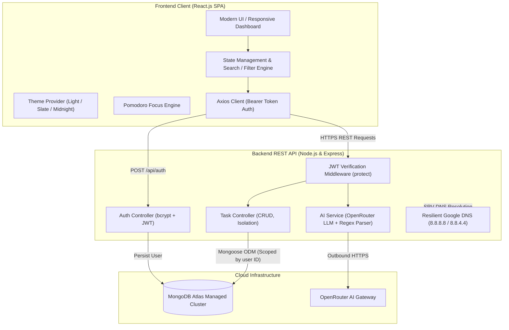

# ⚡ TaskPulse AI — Intelligent Agile Sprint & Task Management Platform

[](https://reactjs.org/)
[](https://openrouter.ai/)
[](https://www.mongodb.com/)
[](https://opensource.org/licenses/MIT)

**TaskPulse AI** is a production-grade, full-stack agile task and sprint management platform engineered to elevate daily developer productivity. Beyond standard CRUD operations, TaskPulse integrates **Generative AI milestone decomposition**, **real-time sprint health analytics**, an **interactive dual-view Kanban board**, a **daily focus agenda**, an **integrated Pomodoro timer**, and **automated standup reporting**.

---

## 📑 Table of Contents
- [Key Features](#-key-features)
- [System Architecture](#-system-architecture)
- [Tech Stack](#-tech-stack)
- [Engineering Challenges & Resilient Solutions](#-engineering-challenges--resilient-solutions)
- [API Reference](#-api-reference)
- [Database Schema](#-database-schema)
- [Local Setup & Installation](#-local-setup--installation)
- [Environment Variables](#-environment-variables)
- [Interview Quick-Reference](#-interview-quick-reference-how-to-explain-this-project)

---

## 🚀 Key Features

### 1. 🤖 AI-Powered Milestone Decomposition Engine
- Integrates with OpenRouter LLMs to break down complex, ambiguous project tasks (e.g., *"Design portfolio website"*, *"Prepare for system design interview"*) into 3–5 actionable, sequential technical subtasks.
- Provides interactive preview modals where developers can inspect, edit, delete, or append custom subtasks before persisting them to the database.
- Features resilient JSON extraction with regex fallback to safely handle markdown-wrapped LLM completions.

### 2. 📊 Real-Time Sprint Health & Analytics Dashboard
- **Total Backlog & Active WIP**: Tracks total tasks and in-progress items with high-priority flags.
- **Sprint Health Progress Bar**: Visual velocity metric calculating percentage of closed vs active tasks.
- **Automated Overdue Warning System**: Proactively flags past-due tasks requiring immediate attention.

### 3. ☀️ "Today's Focus" Daily Agenda
- Toggle high-impact tasks into a dedicated daily agenda banner (`☀️ Today's Focus`).
- Visual daily completion bar keeps developers locked onto primary deliverables without getting overwhelmed by the larger backlog.

### 4. 📋 Interactive Kanban Sprint Board & Agile List View
- Seamlessly toggle between **Structured List View** and a **2-Column Agile Kanban Board** (*In Progress* vs *Completed*).
- Single-click status transitions and live subtask completion percentage bars per card.

### 5. ⏱️ Built-In Pomodoro Focus Timer
- Integrated customizable Pomodoro widget (25-minute Deep Work / 5-minute Short Break).
- 1-click **"🎯 Focus (25m)"** button on individual task cards to immediately bind a task to an active sprint.

### 6. 📝 1-Click Agile Standup Exporter
- Formats today's sprint metrics, completed items, and pending deliverables into clean Markdown.
- Automatically copies directly to clipboard for instant pasting into Slack, Discord, or Microsoft Teams daily standup threads.

### 7. 🎨 Multi-Theme Customization
- Built-in theme switcher supporting **☀️ Clean Light**, **🌫️ Slate Gray**, and **🌙 Midnight Dark**.
- Implemented with CSS design tokens and persisted locally across browser sessions via `localStorage`.

### 8. 🔍 Instant Search & Multi-Attribute Sort
- Real-time client-side search indexing across task titles, descriptions, and individual subtask titles.
- Multi-criteria sorting: **Newest**, **Oldest**, **Due Date (Earliest First)**, and **Priority (High to Low)**.

### 9. 🔒 Secure Multi-Tenant Authentication
- Complete Sign In / Sign Up flow with bcrypt-hashed passwords.
- Stateless JSON Web Token (JWT) authorization header validation on all protected REST endpoints.
- Strict database query isolation (`{ user: req.user._id }`) preventing cross-user data exposure.

---

## 🏛️ System Architecture



---

## 💻 Tech Stack

### Frontend
- **React.js (v19)** — Functional components, Hooks (`useState`, `useEffect`, `useCallback`, `useRef`).
- **Modern CSS3** — CSS custom properties (variables), responsive Flexbox/Grid layouts, zero heavy external UI bloat.
- **Axios** — HTTP client with auth interceptors.

### Backend
- **Node.js & Express 5.x** — Scalable modular RESTful API architecture.
- **MongoDB & Mongoose (v9.x)** — Document database modeling with subdocument schemas and indexing.
- **JSON Web Tokens (JWT)** — Stateless user session management.
- **bcryptjs** — Salted password hashing (10 salt rounds).
- **OpenRouter API** — High-speed LLM integration (`nvidia/nemotron-3.5-lightning:free`).

---

## 🛠️ Engineering Challenges & Resilient Solutions

During development, real-world networking, deployment, and LLM edge cases were identified and systematically resolved:

| Problem / Challenge | Root Cause | Engineering Solution |
| :--- | :--- | :--- |
| **Windows SRV DNS Resolution Failure** | Windows local network DNS failed to resolve MongoDB Atlas `_mongodb._tcp.*` SRV records (`querySrv ECONNREFUSED`). | Injected Google DNS fallbacks (`8.8.8.8`, `8.8.4.4`) directly into Node's `dns` module in `backend/config/db.js` before initializing the database connection. |
| **Corporate/Antivirus TLS Interception** | Local security software intercepted TLS certificates on outbound connections (`unable to verify the first certificate`). | Implemented `{ tlsAllowInvalidCertificates: true }` in Mongoose configuration and custom `https.Agent` for OpenRouter outbound calls. |
| **LLM Output Formatting Inconsistencies** | Free tier LLMs occasionally wrap JSON in markdown code blocks (` ```json ... ``` `) or append conversational pleasantries, crashing `JSON.parse`. | Built a regex extraction pipeline `\[[\s\S]*\]` to isolate raw JSON arrays prior to parsing, with deterministic fallback parsing. |
| **Git Working Tree Bloat** | Unintentional commit of 38,000+ files from `frontend/node_modules/` in initial git repository. | Executed `git rm -r --cached frontend/node_modules`, pruned tree, and reinforced `.gitignore` rules across both workspaces. |
| **Cross-Tenant Data Exposure Prevention** | Risk of authenticated users accessing or modifying tasks created by other accounts. | Enforced strict tenancy checks in `taskController.js`: every database query binds to `req.user._id`, and ID mutations return `403 Forbidden` if ownership mismatch occurs. |

---

## 📡 API Reference

### 🔐 Authentication Endpoints
| Method | Endpoint | Description | Auth Required |
| :--- | :--- | :--- | :--- |
| `POST` | `/api/auth/register` | Register a new user (`name`, `email`, `password`) | No |
| `POST` | `/api/auth/login` | Authenticate user & return signed JWT | No |

### 📋 Task Management Endpoints
| Method | Endpoint | Description | Auth Required |
| :--- | :--- | :--- | :--- |
| `GET` | `/api/tasks` | Fetch all tasks for authenticated user | **Yes** (Bearer) |
| `POST` | `/api/tasks` | Create new task with priority, due date, subtasks | **Yes** (Bearer) |
| `PUT` | `/api/tasks/:id` | Update task status, priority, focus flag, subtasks | **Yes** (Bearer) |
| `DELETE`| `/api/tasks/:id` | Permanently delete task owned by user | **Yes** (Bearer) |

### 🤖 AI Assistance Endpoints
| Method | Endpoint | Description | Auth Required |
| :--- | :--- | :--- | :--- |
| `POST` | `/api/ai/suggest-subtasks` | Generate 3-5 technical subtasks from task title/description | **Yes** (Bearer) |

---

## 🗄️ Database Schema

### User Schema (`backend/models/User.js`)
```javascript
{
  name: { type: String, required: true },
  email: { type: String, required: true, unique: true },
  password: { type: String, required: true }, // bcrypt hashed
  timestamps: true
}
```

### Task Schema (`backend/models/Task.js`)
```javascript
{
  user: { type: mongoose.Schema.Types.ObjectId, ref: 'User', required: true },
  title: { type: String, required: true },
  description: { type: String },
  status: { type: String, enum: ['Pending', 'In Progress', 'Completed'], default: 'Pending' },
  priority: { type: String, enum: ['Low', 'Medium', 'High'], default: 'Medium' },
  dueDate: { type: Date },
  isFocusToday: { type: Boolean, default: false },
  subtasks: [
    {
      title: { type: String, required: true },
      completed: { type: Boolean, default: false }
    }
  ],
  timestamps: true
}
```

---

## ⚙️ Local Setup & Installation

### Prerequisites
- [Node.js](https://nodejs.org/) (v18.x or later)
- [MongoDB Atlas](https://www.mongodb.com/atlas) account or local MongoDB instance
- [OpenRouter](https://openrouter.ai/) free API key

### 1. Clone the Repository
```bash
git clone https://github.com/your-username/task_manager_backend.git
cd task_manager_backend
```

### 2. Configure Backend
```bash
cd backend
npm install
```

Create a `.env` file in the `backend/` directory:
```env
PORT=5000
MONGO_URI=your_mongodb_connection_string
JWT_SECRET=your_jwt_secret_key
OPENROUTER_API_KEY=your_openrouter_api_key
```

Start the backend server:
```bash
# Production mode
npm start

# Development mode (with nodemon auto-reload)
npm run dev
```

### 3. Configure Frontend
Open a separate terminal:
```bash
cd frontend
npm install
npm start
```
The application will launch automatically at `http://localhost:3000`.

---

## 💬 Interview Quick-Reference: How to Explain This Project

When discussing this project with technical recruiters or hiring managers:

> *"TaskPulse AI is a full-stack MERN application I designed to move beyond traditional CRUD to-do apps by tackling real developer pain points: task ambiguity and sprint paralysis.*
>
> *I built an AI-assisted milestone decomposition engine using OpenRouter LLMs that takes a high-level technical goal and breaks it down into structured, sequential subtasks with an interactive preview. To keep developers focused, I implemented real-time sprint health metrics, a dual-view Kanban board, a daily 'Today's Focus' agenda, and an integrated Pomodoro timer.*
>
> *Architecturally, I solved non-trivial challenges including Windows SRV DNS resolution failures for MongoDB Atlas, TLS proxy inspection handling via custom HTTPS agents, robust regex-based LLM JSON parsing, and multi-tenant data segregation with JWT authentication."*

---

## 📄 License
This project is open-source and available under the [MIT License](LICENSE).
